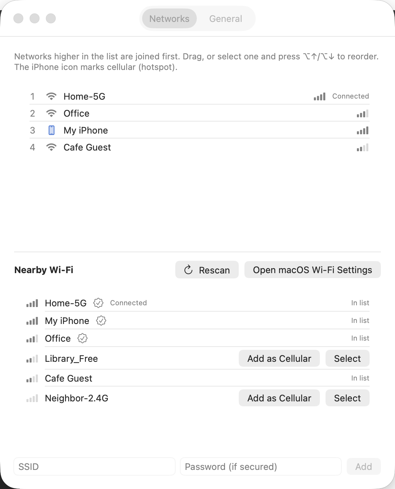

# NetKeeper

[한국어](README.md)

[](https://github.com/sponsors/zzaisang)
[](./LICENSE)

**A macOS menu bar app that keeps you online.**
NetKeeper manages Wi-Fi networks and your iPhone hotspot (cellular) in a single priority list, and switches to the next one as soon as the current network loses internet access.

It was built for a MacBook that is always on and always on the move, so long-running work such as AI agents, builds and syncs doesn't stop because of a network drop.

## Screenshots

| Menu bar popover | Settings |
|---|---|
|  |  |

## Features

- **Priority-based failover**: Wi-Fi and iPhone hotspot share one ordered list. When the internet is actually down, NetKeeper moves to the next network.
- **Real internet checks**: it doesn't just check that Wi-Fi is associated. Every 5 seconds it confirms there is a working internet connection, so it also catches a router that is connected but has no internet.
- **Return to preferred**: while on a fallback network, it keeps scanning and returns to a higher-priority network as soon as one appears.
- **Instant Hotspot**: wakes an idle iPhone that isn't broadcasting, the same way the macOS Wi-Fi menu does.
- **Reuses macOS passwords**: networks already saved in macOS don't need their password entered again.
- **Last 60 minutes**: a one-bar-per-minute timeline of Wi-Fi, cellular and downtime, with switch count and total downtime.
- **Control from the menu bar**: click a network to join it, right-click to reorder.
- **English / 한국어**

## Menu bar icon

There is one icon. Its state is shown by a badge in the bottom-right corner.

| Badge | State |
|---|---|
| None | Online over Wi-Fi |
| Blue dot | Using cellular (iPhone hotspot) |
| Red dot | No internet |
| Gray ring | Auto switch off |

## Requirements

- macOS 15 or later
- Xcode 16 or later (Swift 6 toolchain)

## Install

```sh
git clone https://github.com/zzaisang/netkeeper.git
cd netkeeper
./build.sh
cp -R build/NetKeeper.app /Applications/
open /Applications/NetKeeper.app
```

- `build.sh` signs with an Apple Development certificate if your keychain has one. Otherwise it uses ad-hoc signing, and macOS asks for permissions again after every rebuild.
- To choose the signing identity yourself, run `CODESIGN_IDENTITY="..." ./build.sh`.

## Getting started

1. **Allow Location Services** when prompted on first launch. macOS only reveals nearby Wi-Fi names to apps with location permission.
2. **Add networks**: menu bar icon → Settings… → Networks. Click "Select" next to a network under Nearby Wi-Fi, then click "Add".
3. **Mark your iPhone as cellular**: click "Add as Cellular" next to it in the Nearby list, or right-click it in the popover and choose "Mark as Cellular".
4. **Set the order**: drag, or select a network and press ⌥↑ / ⌥↓.
5. **Allow Accessibility** (only needed for Instant Hotspot): System Settings > Privacy & Security > Accessibility > NetKeeper.
6. **Launch at login**: turn it on in Settings > General.

## Usage

| Action | Result |
|---|---|
| Click a network in the popover | Join it now. It stays joined while it has internet |
| Right-click a network | Move to Top / Up / Down, Mark as Cellular |
| Turn off "Auto" | Stop automatic switching and keep the current network |
| ⌘R / ⌘, / ⌘Q | Refresh / Settings / Quit |

## How it works

1. **Check**: every 5 seconds, and immediately whenever the Wi-Fi link changes, it requests `https://captive.apple.com` to confirm internet access.
2. **Failure**: if a check fails, it checks again 2 seconds later. After 2 failures in a row, that network is skipped for 5 minutes and the next one in the list is joined.
3. **Return**: while on a network other than #1, it scans every 30 seconds and moves back up when a higher-priority network appears.
4. **iPhone hotspot**: it uses Accessibility to press the iPhone's "Personal Hotspot" item in the Control Center Wi-Fi menu, which wakes the iPhone. If that doesn't work, it tries a regular Wi-Fi join.
5. **Passwords**: the app's own keychain entry is used first. If there isn't one, the password is read once per network from the macOS System keychain, which requires administrator approval.

## Settings

| Setting | Default | Range |
|---|---|---|
| Internet check interval | 5 s | 5–60 s |
| Higher-priority scan interval | 30 s | 15–300 s |
| Failed checks before switching | 2 | 1–5 |
| Skip failed network for | 5 min | 1–30 min |
| Language | System default | 한국어 / English |

## Privacy and security

- Wi-Fi passwords are stored in your macOS login keychain, never in a preferences file.
- The only network request NetKeeper makes is the internet check to `captive.apple.com`. No usage data is collected.
- Connection history is kept in memory only and is cleared when the app quits.

## Troubleshooting

| Symptom | Fix |
|---|---|
| The icon isn't in the menu bar | On Macs with a notch, macOS hides menu bar icons that don't fit. Remove some icons or ⌘-drag to rearrange them. If you use a menu bar manager such as Hidden Bar, check its hidden section too. |
| No nearby networks / "Not connected" | Turn on NetKeeper in System Settings > Privacy & Security > Location Services. |
| An administrator password prompt appears | NetKeeper is reading a Wi-Fi password saved in macOS. This happens only once per network. To avoid it, enter the password in Settings instead. |
| It doesn't switch to the iPhone hotspot | Check the Accessibility permission. The iPhone and Mac must use the same Apple Account, with Bluetooth on for both. |
| Permissions are requested again after a rebuild | The build was ad-hoc signed. Sign it with an Apple Development certificate. |

## Project layout

```
Sources/NetKeeper/
  Decision.swift           picks the next network (pure logic)
  ConnectionHistory.swift  last 60 minutes of history
  Keychain.swift           password storage
  Keeper.swift             monitoring and switching service
  InstantHotspot.swift     Instant Hotspot join (Accessibility)
  MenuBarIcon.swift        menu bar icon and badge
  MenuView.swift           menu bar popover
  SettingsView.swift       settings window
  NetKeeperApp.swift       app entry point
Resources/                 localizations (en.lproj, ko.lproj)
Tests/NetKeeperTests/      unit tests
```

## Development

```sh
swift test      # unit tests
./build.sh      # build the app bundle
```

- **Localization**: the development language is Korean, and the Korean source text is used as the localization key. When you add UI text, also add its English translation to `Resources/en.lproj/Localizable.strings`. Otherwise the Korean text shows up in the English UI.
- **Logs**: `log stream --predicate 'subsystem == "com.zzaisang.NetKeeper"'`

## Known limitations

- Instant Hotspot has no public API. NetKeeper relies on the Control Center accessibility identifier (`wifi-network-<SSID>`). If a macOS update changes it, `InstantHotspot.swift` needs to be updated.
- Secured Wi-Fi networks can only be joined when the app has their password.
- Connection history resets when the app restarts.

## Sponsor

NetKeeper is free and MIT-licensed. If it saves you time, you can support its development:

[](https://github.com/sponsors/zzaisang)

## License

[MIT](./LICENSE)
