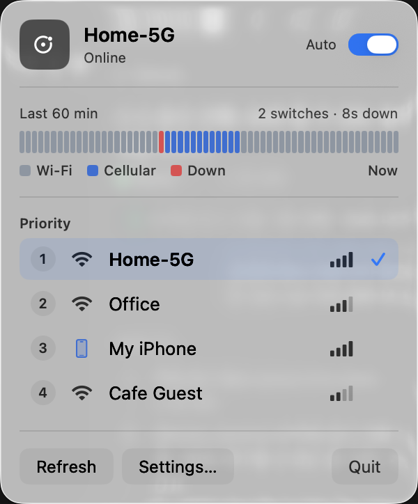

# NetKeeper

[한국어](README.md)

[](https://github.com/sponsors/zzaisang)
[](./LICENSE)

**A macOS menu bar app that keeps you online.**
NetKeeper manages your Wi-Fi networks and iPhone hotspot in one priority list, and switches to the next network automatically when the internet drops.

## Screenshots

| Menu bar popover | Settings |
|---|---|
|  |  |

## Features

- **Priority-based failover**: when the internet actually drops, NetKeeper moves to the next network, and returns once a higher-priority network is back.
- **Real internet checks**: every few seconds it confirms the internet actually works, not just that Wi-Fi is connected.
- **iPhone hotspot**: wakes an idle iPhone and joins its hotspot, just like the macOS Wi-Fi menu.
- **Saved passwords**: networks already saved in macOS don't need their password entered again.
- **Last 60 minutes**: Wi-Fi, cellular and downtime at a glance, with the number of switches.
- **Control from the menu bar**: click a network to join it, right-click to change its priority.
- **English / 한국어**

## Menu bar icon

| Badge | State |
|---|---|
| None | Online over Wi-Fi |
| Blue dot | Using cellular (iPhone hotspot) |
| Red dot | No internet |
| Gray ring | Auto switch off |

## Requirements

- macOS 15 or later
- Xcode 16 or later

## Install

```sh
git clone https://github.com/zzaisang/netkeeper.git
cd netkeeper
./build.sh
cp -R build/NetKeeper.app /Applications/
open /Applications/NetKeeper.app
```

## Getting started

1. Allow **Location Services** on first launch. NetKeeper needs it to see nearby Wi-Fi names.
2. Open the menu bar icon → **Settings…** → Networks, and add networks from the Nearby Wi-Fi list.
3. Click **Add as iPhone Hotspot** next to your iPhone. If its name has no "iPhone", add it to the list and turn on the **iPhone Hotspot** toggle.
4. Set the order by dragging, or with ⌥↑ / ⌥↓.
5. To use your iPhone hotspot, turn on NetKeeper in System Settings > Privacy & Security > **Accessibility**.
6. Turn on **Launch at login** in Settings > General.

## Settings

| Setting | Default |
|---|---|
| Internet check interval | 5 s |
| Higher-priority scan interval | 30 s |
| Failed checks before switching | 2 |
| Skip failed network for | 5 min |
| Language | System default |

## Privacy

- Wi-Fi passwords are stored only in the macOS keychain.
- Apart from the internet check (`captive.apple.com`), NetKeeper makes no network requests and collects no data.

## Sponsor

NetKeeper is free and MIT-licensed. If it saves you time, you can support its development:

[](https://github.com/sponsors/zzaisang)

## License

[MIT](./LICENSE)
