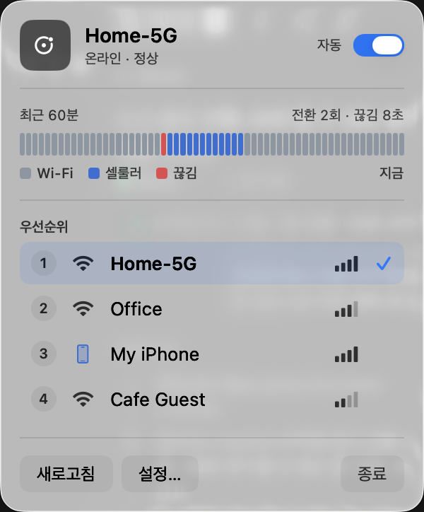
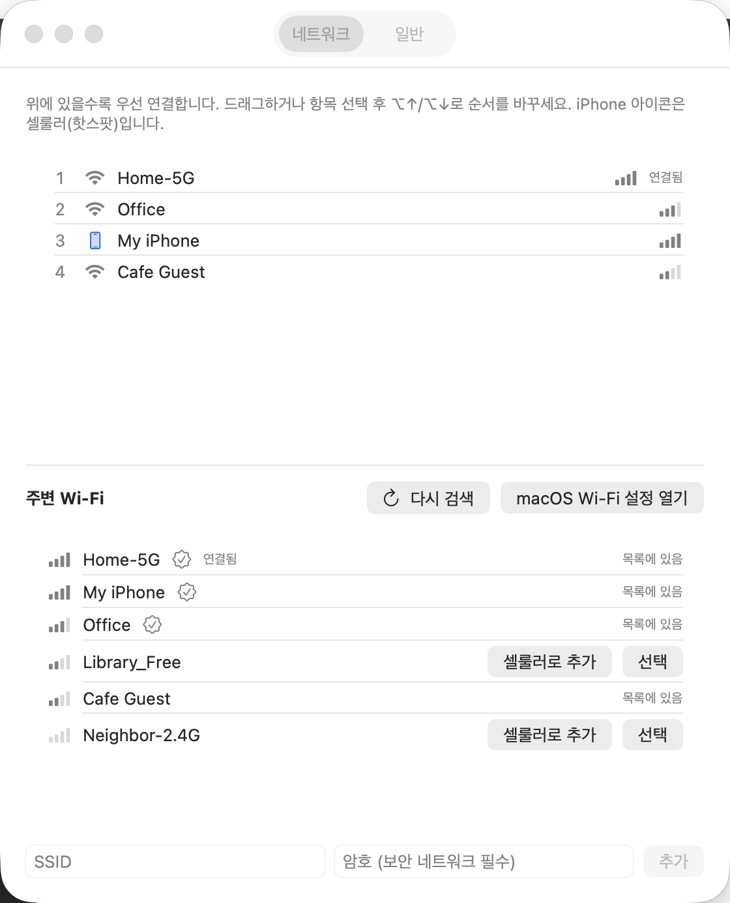

# NetKeeper

[English](README.en.md)

[](https://github.com/sponsors/zzaisang)
[](./LICENSE)

**인터넷이 끊기지 않게 지켜 주는 macOS 메뉴바 앱.**
Wi-Fi와 iPhone 핫스팟을 하나의 우선순위 목록으로 관리하고, 인터넷이 끊기면 다음 네트워크로 자동 전환합니다.

## 스크린샷

| 메뉴바 팝오버 | 설정 |
|---|---|
|  |  |

## 주요 기능

- **우선순위 자동 전환**: 인터넷이 실제로 끊기면 다음 순위 네트워크로 넘어가고, 상위 네트워크가 다시 잡히면 돌아갑니다.
- **실제 인터넷 확인**: Wi-Fi 연결 여부가 아니라 실제로 인터넷이 되는지를 몇 초마다 확인합니다.
- **iPhone 핫스팟 연결**: 대기 중인 iPhone도 macOS Wi-Fi 메뉴처럼 깨워서 연결합니다.
- **저장된 암호 재사용**: macOS에 이미 저장된 Wi-Fi는 암호를 다시 입력하지 않아도 됩니다.
- **최근 60분 기록**: Wi-Fi·셀룰러·끊김 구간과 전환 횟수를 한눈에 보여줍니다.
- **메뉴바에서 바로 조작**: 클릭하면 바로 연결하고, 우클릭하면 우선순위를 바꿉니다.
- **한국어 / English**

## 메뉴바 아이콘

| 뱃지 | 상태 |
|---|---|
| 없음 | Wi-Fi 정상 |
| 파랑 점 | 셀룰러(iPhone 핫스팟) 사용 중 |
| 빨강 점 | 인터넷 끊김 |
| 회색 고리 | 자동 전환 꺼짐 |

## 요구 사항

- macOS 15 이상
- Xcode 16 이상

## 설치

```sh
git clone https://github.com/zzaisang/netkeeper.git
cd netkeeper
./build.sh
cp -R build/NetKeeper.app /Applications/
open /Applications/NetKeeper.app
```

## 시작하기

1. 첫 실행 때 **위치 서비스**를 허용합니다. 주변 Wi-Fi 이름을 확인하는 데 필요합니다.
2. 메뉴바 아이콘 → **설정…** → 네트워크 탭에서 주변 Wi-Fi를 선택해 추가합니다.
3. iPhone 옆의 **셀룰러로 추가**를 누릅니다.
4. 드래그하거나 ⌥↑ / ⌥↓로 우선순위를 정합니다.
5. iPhone 핫스팟을 쓰려면 시스템 설정 > 개인정보 보호 및 보안 > **손쉬운 사용**에서 NetKeeper를 켭니다.
6. 설정 > 일반에서 **로그인 시 실행**을 켭니다.

## 설정

| 항목 | 기본값 |
|---|---|
| 인터넷 확인 주기 | 5초 |
| 상위 네트워크 탐색 주기 | 30초 |
| 불통으로 판정할 연속 실패 횟수 | 2회 |
| 불통 네트워크 제외 시간 | 5분 |
| 언어 | 시스템 설정 따름 |

## 개인정보

- Wi-Fi 암호는 macOS 키체인에만 저장합니다.
- 인터넷 확인(`captive.apple.com`) 외에는 외부와 통신하지 않으며, 어떤 데이터도 수집하지 않습니다.

## 후원

NetKeeper는 무료이며 MIT 라이선스로 공개됩니다. 도움이 되셨다면 개발을 후원해 주세요.

[](https://github.com/sponsors/zzaisang)

## 라이선스

[MIT](./LICENSE)
